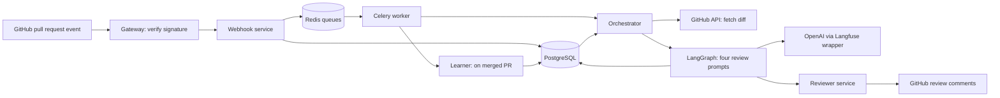

# AI GitHub Pull Request Reviewer

A Python service-based example that receives GitHub pull request events, asks an LLM to review the diff, and posts findings back to the pull request. It includes database migrations, background workers, local container configuration, and AWS deployment templates.

This repository packages supplied project materials for inspection and experimentation. The downloaded bundle references [data-guru0/GitHub-PR-Code-AI-Reviewer](https://github.com/data-guru0/GitHub-PR-Code-AI-Reviewer) as its source. No license file was included in the bundle; this repository does not add a new license or claim original authorship.

## Features

- HMAC-SHA256 verification of incoming GitHub webhooks.
- Handling of `opened`, `reopened`, and `synchronize` events, with a database lookup to skip a previously seen repository/PR/head-SHA combination.
- Celery tasks backed by Redis for review requests and merge-triggered learning requests.
- A LangGraph workflow with four LLM prompts: static analysis, security, style, and architecture. These are model-based reviews, not executions of static analyzers or security scanners.
- GitHub App installation tokens for fetching diffs and submitting review comments. Invalid inline comment locations trigger a summary-only fallback on HTTP 422.
- PostgreSQL storage for pull requests, findings, and recurring warning/error messages used as style-review context.
- `/health` and `/metrics` endpoints on each HTTP service; Prometheus and Grafana configuration; a Langfuse-wrapped OpenAI client.
- An optional Ragas evaluation script over stored findings.

The project is an example with known functional and deployment limitations, described below. A successful health response does not verify its integrations.

## Technology stack

| Area | Technologies |
| --- | --- |
| Services | Python 3.11 container images, FastAPI, Uvicorn, Pydantic settings, HTTPX |
| Review workflow | LangGraph, OpenAI client, `gpt-4o-mini` hardcoded in the graph, Langfuse |
| Persistence and queues | PostgreSQL 15, SQLAlchemy async, asyncpg, Alembic, Celery, Redis 7 |
| GitHub integration | GitHub App JWTs with PyJWT and cryptography, signed webhooks, REST API |
| Containers and infrastructure | Docker Compose, Kubernetes, Terraform, AWS EKS/ECR/RDS/ElastiCache/S3 |
| Monitoring and evaluation | Prometheus, Grafana, Ragas, Hugging Face datasets |
| Automation | GitHub Actions with optional AWS OIDC deployment |

## Architecture



The review path uses ports 8000–8004 for gateway, webhook, orchestrator, reviewer, and learner respectively. Internal URLs are hardcoded to these service names. Compose provides that DNS and runs both Celery queues from the webhook image, where both tasks are actually registered.

The original [architecture image](docs/architecture/Architecture%20Diagram.png) and [Mermaid source](docs/architecture/final-diagram.mmd) are included as design references. They describe intended behavior; the limitations below take precedence over their claims about deduplication and learning.

## Installation and configuration

Use Docker Engine/Desktop with Compose v2 for the local stack. Python 3.11 is useful for running an individual service without containers. Run commands below from the repository root in a POSIX shell.

```sh
cp .env.example .env
```

Edit `.env` before starting the stack. The [environment example](.env.example) contains placeholders, not usable credentials.

| Variable | Purpose |
| --- | --- |
| `POSTGRES_USER`, `POSTGRES_PASSWORD`, `POSTGRES_DB` | Initialize the local PostgreSQL container. Changing these later does not update an existing database volume. |
| `DATABASE_URL` | Async SQLAlchemy URL; use `postgresql+asyncpg://` and match the local database credentials. URL-encode password characters that have special meaning in URLs. |
| `REDIS_URL` | Celery broker and result backend; Compose uses `redis://redis:6379/0`. |
| `GITHUB_WEBHOOK_SECRET` | Shared secret configured in the GitHub App and used by the gateway. Set a nonempty random value. |
| `GITHUB_APP_ID`, `GITHUB_APP_PRIVATE_KEY` | App ID and RSA private key for installation-token requests. Store the PEM on one line with literal `\n` between lines; the application expands them. |
| `OPENAI_API_KEY` | Credential used by the orchestrator and optional evaluation script. |
| `LANGFUSE_PUBLIC_KEY`, `LANGFUSE_SECRET_KEY`, `LANGFUSE_HOST` | Optional tracing configuration. |
| `LANGFUSE_TRACING_ENABLED` | SDK setting; the example disables tracing until configured. |

Configure a GitHub App with repository contents read access and pull requests read/write access, subscribe it to pull request events, and install it on a test repository. Use `https://YOUR_WEBHOOK_HOST/webhook/github` for its webhook URL. For local testing, provide an HTTPS tunnel or reverse proxy to `127.0.0.1:8000` and use the same webhook secret on both sides. Do not expose the internal services directly; they do not authenticate callers.

Compose reads `.env` and injects process environment variables. Avoid copying the combined file into service directories: their Pydantic settings classes define different fields and can reject unrelated dotenv keys. The OpenAI client and Celery workers also read process environment variables directly.

## Run locally

```sh
docker compose config --quiet
docker compose up --build -d
# The migration container exits successfully after creating the schema.
docker compose ps -a
docker compose logs --tail=100 migrate gateway worker orchestrator reviewer learner
curl --fail http://127.0.0.1:8000/health
```

Compose starts PostgreSQL and Redis, runs `alembic upgrade head`, and starts the five services plus one worker consuming both `webhook` and `learning` queues. Only the gateway is published on the host. Its interactive API docs are at `http://127.0.0.1:8000/docs` and metrics at `http://127.0.0.1:8000/metrics`.

Open a pull request in the test repository and inspect the GitHub webhook delivery and worker/orchestrator/reviewer logs. An HTTP 202 response only acknowledges the request; it does not establish that a review was posted. See the functional limitations before relying on merge-triggered learning.

```sh
# Stop containers while retaining the local database volume.
docker compose down
```

For isolated gateway development, install its dependencies in a virtual environment and export its setting. Full review processing still requires the other service hostnames to resolve.

```sh
python3.11 -m venv .venv
. .venv/bin/activate
python -m pip install -r services/gateway/requirements.txt
export GITHUB_WEBHOOK_SECRET='replace-with-your-local-secret'
(cd services/gateway && uvicorn main:app --host 127.0.0.1 --port 8000)
```

For migrations against a separately managed database, install `services/webhook/requirements.txt`, export `DATABASE_URL`, and run `(cd db && alembic upgrade head)`. The working directory matters because `db/alembic.ini` uses a relative migration path.

## AWS and Kubernetes templates

The [Terraform files](infra/terraform/main.tf) describe a VPC, EKS cluster, RDS PostgreSQL, ElastiCache Redis, ECR repositories, and an S3 bucket. They require `cluster_name` and `db_password`; `region` defaults to `us-east-1` and `environment` to `staging`. Terraform state and real `.tfvars` files are ignored. The S3 bucket is declared but no application report-upload path is implemented.

These are deployment templates, not a turnkey production deployment. Before using them:

1. Choose an available EKS version and a globally unique S3 bucket name. Review public subnet placement, broad load-balancer IAM permissions, deletion settings, database backups, Redis access, and TLS.
2. Provision the GitHub Actions OIDC role referenced by Terraform (`github-actions-ai-reviewer`) and the EKS access entry. The templates reference the role but do not create it. Install/configure the load-balancer controller and metrics server separately as needed.
3. Supply your own Terraform variables, then run `terraform -chdir=infra/terraform init`, `terraform -chdir=infra/terraform validate`, and `terraform -chdir=infra/terraform plan`. Review the plan before applying it in your own AWS account.
4. Build each image from the repository root, for example `docker build -f services/gateway/Dockerfile -t YOUR_REGISTRY/gateway:YOUR_TAG .`, and push it to your registry. Replace every `REGISTRY_PLACEHOLDER` in the Kubernetes manifests with that registry and select the tags to deploy.
5. Replace `REDIS_HOST` in [configmap.yaml](infra/k8s/configmap.yaml). Copy [secret.example.yaml](infra/k8s/secret.example.yaml) to the ignored `infra/k8s/secret.yaml` and fill in your credentials and database endpoint. The `*_SERVICE_URL` entries in the ConfigMap are currently unused by the application.
6. Apply the ConfigMap and real Secret, run [migration-job.yaml](infra/k8s/migration-job.yaml) to completion, then apply the selected service and worker manifests. Do not apply the entire directory indiscriminately: it includes placeholder examples and an optional evaluation job. The learner-worker template needs correction as described below.
7. Choose the gateway LoadBalancer Service or ALB ingress, configure HTTPS, and update the GitHub App webhook URL. Do not assume the provided HTTP-only ingress includes TLS.

The per-service GitHub Actions workflows install dependencies and compile Python. They do not run an application test suite. AWS image publication and deployment require repository variable `ENABLE_AWS_DEPLOY=true` and repository secrets `AWS_ROLE_ARN`, `AWS_ACCOUNT_ID`, and `EKS_CLUSTER_NAME`. They use `us-east-1` and update existing deployments; they do not bootstrap the cluster or initial deployments. Worker deployments are not updated by these workflows.

The weekly/manual evaluation workflow is gated separately by `ENABLE_AWS_EVALUATION=true`. It builds [scripts/Dockerfile](scripts/Dockerfile), runs a Kubernetes job, prints logs, and cleans up the job. The [evaluation script](scripts/evaluate.py) reads up to 50 recent findings and uses file names as contexts, so its faithfulness score is not evidence that the review is correct. Empty data exits successfully without evaluating anything. Evaluation makes model calls and requires database access and an API key.

## Monitoring

Every HTTP service exposes `/metrics`. [prometheus.yml](monitoring/prometheus.yml) lists the service DNS names and ports; [grafana-dashboard.json](monitoring/grafana-dashboard.json) is an importable dashboard. Prometheus, Grafana, and Langfuse servers are not included in the local Compose stack. Deployment and connectivity of those systems must be configured separately.

## Project structure

```text
.github/workflows/       Per-service CI and optional AWS deployment/evaluation
services/
  gateway/              Signature verification and event forwarding
  webhook/              Event persistence and both registered Celery tasks
  orchestrator/         Diff fetching, LangGraph prompts, finding persistence
  reviewer/             GitHub inline comments and summary reviews
  learner/              Pattern aggregation and an incomplete worker stub
db/                     Alembic configuration and initial schema migration
infra/
  k8s/                  Kubernetes templates and placeholder Secret
  terraform/            AWS infrastructure definitions
monitoring/             Prometheus configuration and Grafana dashboard
scripts/                Database-backed evaluation script and its Dockerfile
docs/architecture/      Supplied design diagrams
compose.yaml            Local database, queue, migration, services, and worker
.env.example            Placeholder local settings
```

The original download is retained locally in `_local_backup/` and excluded from Git and Docker build contexts. It may contain credentials and must not be published.

## Known limitations

- Service dependencies are largely unpinned, and there is no lockfile or automated application test suite. Dependency compatibility and complete container startup have not been established by syntax checks.
- The graph combines an additive findings reducer with a merge node that returns the merged list. This can append findings again instead of replacing the original collection; deduplication is not guaranteed.
- Model JSON is not validated against a finding schema. Parse failures become an empty list, and syntactically valid but malformed responses can fail later. There is no diff-size limit, chunking, or implemented prompt-injection defense. Review diffs are sent to the model provider and may be traced when tracing is enabled.
- Synchronous graph/model calls run inside an async request handler. Worker HTTP calls use fixed timeouts and do not check unsuccessful HTTP status codes or configure task retries. The orchestrator also does not check the reviewer's response status.
- Deduplication is a query without a matching unique constraint; concurrent events can race. Merge-event lookup uses only repository and PR number, so multiple recorded head SHAs can make `scalar_one_or_none()` fail.
- The Kubernetes learner worker loads `services/learner/worker.py`, which registers no learning task. Use the webhook image/module to consume the learning queue; Compose already does this. Separately, the learner ORM refers to `pull_requests` without defining that table in its metadata, which can prevent flushing learned patterns. Learning is not verified end to end.
- An empty review returns without marking the PR reviewed. Inline locations and model findings are not independently checked for correctness.
- Health endpoints return a static response. They do not test the database, Redis, GitHub, model access, or worker task registration.
- Infrastructure templates require operator configuration and include public endpoints, HTTP-only ingress, broad IAM permissions, no Redis authentication/TLS configuration, and destructive resource deletion settings. They are not production-hardened.

## Validation status

Publication preparation checks syntax, configuration structure, local documentation targets, and tracked content for credential patterns. It does not establish review quality, GitHub delivery, model access, database migration success, cloud deployment, or monitoring behavior. See the [validation record](docs/validation.md) for the completed checks and environment limitations.
